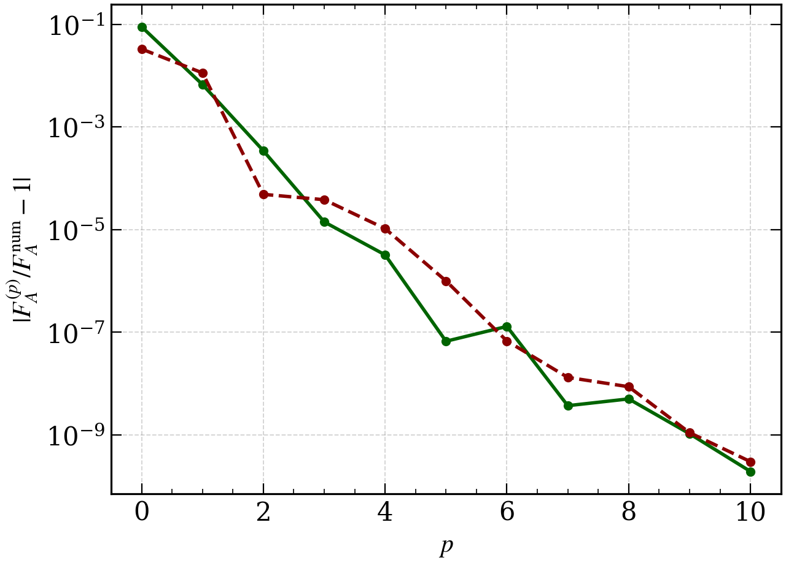

# N10LO: generation beyond published low-order formulas

This case generates both spectra at `p=10` and the first tensor running
$\alpha_1^t$ at `n=1,p=10`, hence $W=12$. The published
[equation documents](../../../results/README.md) contain the spectra and tensor
tilt at this order. The validated first tensor running can be generated with
`SRI -n 1 -p 10`, separately from these validation checks.
These checks use numerical coefficients regenerated from the mode equations.

There is no published order-ten coefficient table used as a target. Validation
therefore comes from independently solved equations, exact limits and formal
substitution identities.



Relative amplitude errors against independent scalar (darkgreen, solid) and tensor
(darkred, dashed) modes, for the nonconstant canonical background
$a(x)=x^{-1}\exp[-e(x^b-1)/b]$, $x=-k\eta$, $e=0.08$, $b=0.073$.
The reference is evaluated at $x=1$ and both polarizations are included for tensors.
The coefficient tests below check the formal SR order directly, even where
finite-parameter remainders happen to cancel.

## What is checked

- All 138 generated universal moments against a separately implemented linear mode and growing-pump solver, with two independent integration resolutions.
- All growing-pump polynomials by exact comparison before integration.
- Available Gamma/Mellin coefficients as mathematical oracles, with no literature table.
- Exact constant-`epsilon` Hankel amplitudes and remainder scaling for every `p=0,...,10`.
- Individual scalar and tensor parameter-Taylor coefficients through `p=10` for the nonconstant canonical background.
- Direct finite-parameter scalar and tensor modes at three background rescalings, with refined initial conditions, integration and freeze-out.
- The `n=1,p=10` consistency relation by exactly zero forward-substitution residual, correct weights, observable-only output, the zero-`r` limit and the constant-`epsilon` specialization.

## Reproduce

Open [validation.ipynb](validation.ipynb). It displays the saved validation results by default; set `RERUN=True` for a new full calculation.
From the repository root:

```bash
python -m validation.canonical_SRI.order_cases --p 10
```

That command regenerates the coefficient bank from the mode equations.

## Spectra

- [Generated equations (PDF)](../../../results/canonical_SRI/N10LO/N10LO.pdf)
- [LaTeX source](../../../results/canonical_SRI/N10LO/N10LO.tex)
- [YAML expressions](../../../results/canonical_SRI/N10LO/N10LO.yaml)
